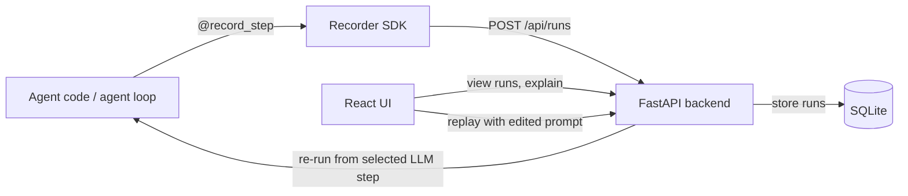

# Agent Flight Recorder

A black box for AI agents: see why an agent failed, change one step, and replay from there.

## The problem

AI agents can take several LLM and tool steps before producing an incorrect result, making the cause hard to spot. For example, an agent asked to delete a duplicate customer might find two Priya Sharma records and delete the active customer's record instead. Without a trace of prompts, tool calls, and outputs, it is difficult to see where the decision went wrong or test a correction safely.

## How it works

The recorder captures agent steps and sends each run to the backend, which stores it in SQLite for the React interface to display. Replaying a run sends the edited prompt through the backend to the agent loop, starting at the selected LLM step.



## Features

- **Recording:** Capture LLM and tool inputs, outputs, errors, latency, and token/cost estimates for each run.
- **Timeline:** Inspect recorded steps and their details in order.
- **Failure explanation:** Ask for a short explanation of where a run likely failed.
- **Replay:** Change a prompt and replay from any recorded LLM step.
- **Comparison:** View the original and replay side by side, including a prompt diff, changed steps, outcomes, and costs.

## Quick start (Windows PowerShell)

From the project root, install the Python requirements:

```powershell
python -m pip install -r requirements.txt
```

Start the backend in one PowerShell window and leave it running:

```powershell
uvicorn backend.main:app --reload
```

In a second PowerShell window, from the project root, run the demo agent:

```powershell
python -m demo_agent.run_demo
```

In a third PowerShell window, start the frontend:

```powershell
cd frontend
npm install
npm run dev
```

Open the local URL printed by Vite (usually `http://localhost:5173`). The demo run should appear in the run list.

## Demo walkthrough

1. Open the `duplicate-customer-demo` run from the run list.
2. Click **Explain failure** to locate the likely failure step.
3. Select LLM **step 2**, add the instruction `Verify the customer status and delete only the record marked duplicate.`, then click **Replay from this step**.
4. Click **Compare with original** on the replay to inspect the prompt diff, changed steps, and outcomes side by side.

## Honest limitations

- The demo uses a scripted mock LLM unless `ANTHROPIC_API_KEY` is set. The real-model path is not load-tested.
- Replay resets the demo's in-memory customer database, so side effects from earlier steps are not re-applied. Earlier trace steps are inherited in the replay for comparison.
- Without an API key, the failure explainer uses a keyword-based rule rather than real analysis.
- The app has no authentication.
- Run storage uses SQLite only.
- Cost estimates use fixed example prices, not live provider pricing.

## Project structure

```text
.
├── backend/
│   ├── db.py                 # SQLite storage
│   ├── explainer.py          # Failure explanation
│   └── main.py               # FastAPI endpoints
├── demo_agent/
│   ├── agent.py              # Tool-calling agent and mock LLM
│   ├── run_demo.py           # Demo entry point
│   └── tools.py              # Demo customer database and tools
├── frontend/
│   ├── src/
│   │   ├── App.jsx           # Runs, timeline, replay, and comparison UI
│   │   ├── main.jsx
│   │   └── style.css
│   ├── index.html
│   ├── package.json
│   └── vite.config.js
├── sdk/
│   ├── flight_recorder/
│   │   └── recorder.py       # Recorder and @record_step decorator
│   └── pyproject.toml
├── requirements.txt
└── README.md
```

## Roadmap

- Add a LangGraph adapter.
- Add a memory-debugging view.
- Add authentication.

   